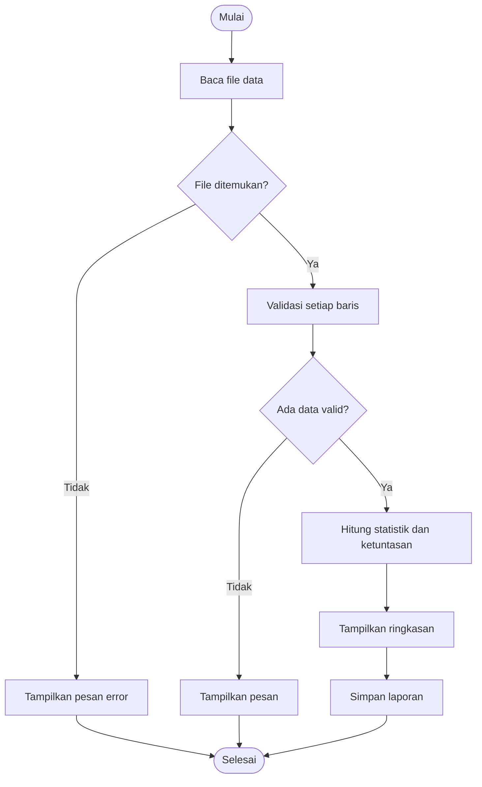

# Proposal Proyek: Program Rekap dan Analisis Nilai Matematika Kelas

Mata kuliah: Algoritma dan Pemrograman, S1 Pendidikan Matematika FKIP Untirta (2026/2027 Ganjil)
Tim: solo
Anggota: Wulan Nur'aini 2225250131
Repository: https://github.com/wulannuraini699/proyek-akhir-wulan-nuraini-solo.git

## 1. Judul Proyek

Program Rekap dan Analisis Nilai Matematika Kelas

## 2. Latar Belakang

Guru matematika secara rutin merekap nilai tugas atau ulangan siswa untuk mengetahui rata-rata kelas,
nilai tertinggi dan terendah, serta jumlah siswa yang sudah mencapai Kriteria Ketuntasan Minimal (KKM).
Jika dilakukan manual, proses ini lambat dan mudah salah, terutama ketika ada nilai yang salah ketik
(misalnya 105 atau huruf pada kolom nilai) atau ketika datanya banyak. Program sederhana berbasis
terminal dapat membaca data dari file, memeriksa kebenaran nilai, menghitung statistik, dan menyimpan
laporan secara konsisten.

## 3. Pengguna dan Tujuan

**Pengguna utama:** guru matematika.

**User story:** Sebagai guru matematika, saya ingin membaca data nilai siswa dari file, agar saya
memperoleh statistik dan status ketuntasan secara otomatis tanpa menghitung manual.

**Tujuan:**
1. Membaca data nilai dari file teks.
2. Menolak data tidak valid dengan pesan yang jelas tanpa menghentikan seluruh proses.
3. Menghasilkan statistik kelas dan status ketuntasan.
4. Menyimpan laporan ke file agar dapat diarsipkan.

## 4. Ruang Lingkup

**Fitur wajib (dikerjakan sampai Pertemuan 15):** F01 sampai F05 pada bagian 5.

**Fitur tambahan (hanya jika waktu tersisa):** F06 statistik per kategori (misalnya distribusi rentang nilai).

**Batasan proyek:**
- Program berbasis terminal (console) dengan Python 3, tanpa antarmuka grafis atau web.
- Input berupa file teks berformat `NIM,nama,nilai` (satu siswa per baris). Tidak ada input langsung dari keyboard.
- Satu file data diproses per eksekusi, dan hanya satu kolom nilai per siswa.
- Tidak memakai layanan eksternal atau library di luar Python standar.
- Data contoh bersifat fiktif dan tidak memuat informasi pribadi nyata.

## 5. Kebutuhan

### Kebutuhan fungsional

| ID | Kebutuhan | Prioritas |
|----|-----------|-----------|
| F01 | Program dapat membaca data nilai dari file | Wajib |
| F02 | Program memvalidasi nilai pada rentang 0 sampai 100 serta format baris | Wajib |
| F03 | Program menghitung rata-rata, minimum, dan maksimum | Wajib |
| F04 | Program menentukan status tuntas atau belum tuntas berdasarkan KKM | Wajib |
| F05 | Program menyimpan laporan ke file | Wajib |
| F06 | Program menampilkan statistik per kategori | Tambahan |

### Kebutuhan nonfungsional

- Mudah dijalankan dari terminal VS Code (`python3 src/main.py`).
- Pesan kesalahan mudah dipahami (menyebut nomor baris dan alasan penolakan).
- Nama fungsi dan variabel jelas; satu fungsi satu tanggung jawab.
- Data contoh tidak mengandung informasi pribadi nyata.
- Dapat diuji ulang dengan test case yang sama (`python3 tests/test_otomatis.py`).

## 6. Input, Proses, Output (IPO)

| Komponen | Rancangan |
|----------|-----------|
| **Input** | File `data/nilai_contoh.txt` (format `NIM,nama,nilai`); nilai KKM (default 70, opsional lewat argumen) |
| **Proses** | Baca file, lewati baris kosong, validasi format dan rentang nilai, tolak duplikat NIM, simpan data valid ke dictionary, hitung statistik, hitung ketuntasan |
| **Output** | Pesan baris yang ditolak, ringkasan statistik dan daftar status di terminal, serta file `output/laporan.txt` |

## 7. Algoritma

### Pseudocode

```
MULAI
  tentukan path_data, kkm, path_laporan
  coba baca data dari file
  jika file tidak ditemukan:
      tampilkan pesan error
      SELESAI
  untuk setiap baris data:
      jika baris kosong: lewati
      jika format bukan NIM,nama,nilai: catat sebagai ditolak, lanjut
      jika nilai bukan angka: catat sebagai ditolak, lanjut
      jika nilai di luar 0-100: catat sebagai ditolak, lanjut
      jika NIM sudah ada: catat sebagai ditolak, lanjut
      simpan (nim, nama, nilai) ke data valid
  tampilkan baris yang ditolak beserta alasan
  jika tidak ada data valid:
      tampilkan pesan
      SELESAI
  hitung jumlah, rata-rata, minimum, maksimum
  hitung jumlah tuntas dan belum tuntas berdasarkan kkm
  tampilkan ringkasan
  simpan laporan ke file
SELESAI
```

### Diagram alur



## 8. Struktur Program

### Fungsi dan modul

| Fungsi | File | Tanggung jawab | Input | Output |
|--------|------|----------------|-------|--------|
| `baca_data()` | `data_io.py` | Membaca dan memvalidasi file | path | data valid dan daftar baris ditolak |
| `simpan_laporan()` | `data_io.py` | Menulis laporan ke file | path, teks | efek: file tertulis |
| `validasi_nilai()` | `utilitas.py` | Memeriksa rentang 0-100 | nilai | bool |
| `format_laporan()` | `utilitas.py` | Menyusun teks laporan | data, statistik, ketuntasan | string |
| `hitung_statistik()` | `analisis.py` | Menghitung ringkasan data | data | dictionary statistik |
| `tentukan_status()` | `analisis.py` | Menentukan ketuntasan satu nilai | nilai, kkm | string |
| `hitung_ketuntasan()` | `analisis.py` | Menghitung jumlah tuntas dan belum | data, kkm | (tuntas, belum) |
| `main()` | `main.py` | Mengatur alur program | path, kkm | kode status |

### Struktur folder

```
proyek-akhir-nama-tim/
|-- README.md
|-- proposal.md
|-- .gitignore
|-- data/
|   `-- nilai_contoh.txt
|-- src/
|   |-- main.py
|   |-- data_io.py
|   |-- analisis.py
|   `-- utilitas.py
|-- tests/
|   |-- test_case.md
|   `-- test_otomatis.py
`-- output/
    `-- .gitkeep
```

Pemisahan modul mengikuti tanggung jawab: `data_io.py` berurusan dengan file, `analisis.py`
berisi perhitungan, `utilitas.py` berisi validasi dan format, dan `main.py` hanya mengatur alur.

## 9. Struktur Data

| Kebutuhan | Struktur | Alasan |
|-----------|----------|--------|
| Data per siswa | Dictionary bersarang `{nim: {"nama": ..., "nilai": ...}}` | Akses cepat berdasarkan NIM dan otomatis mencegah NIM ganda |
| Daftar nilai untuk statistik | List (dibentuk dari dictionary) | Mudah dihitung dengan `sum`, `min`, `max`, `len` |
| Baris yang ditolak | List of tuple `(nomor, baris, alasan)` | Urutan terjaga dan mudah ditampilkan |
| Statistik | Dictionary | Nilai bernama (`rata_rata`, `minimum`, ...) mudah dibaca |
| Teks laporan | String | Mudah diformat dan ditulis ke file |

## 10. Test Case

Ringkasan (detail dan hasil ada di `tests/test_case.md`):

| ID | Kategori | Input/Kondisi | Expected Result |
|----|----------|---------------|-----------------|
| TC01 | Normal | Nilai 80, 70, 90 | Rata-rata 80 |
| TC02 | Batas | Nilai 0 | Diterima sebagai nilai valid |
| TC03 | Batas | Nilai 100 | Diterima sebagai nilai valid |
| TC04 | Invalid | Nilai 105 | Ditolak dengan pesan validasi |
| TC05 | Invalid | File tidak ada | Pesan error, program tidak crash |
| TC06 | Normal | Semua nilai >= KKM | Jumlah tuntas = jumlah data |
| TC07 | Batas | Nilai tepat sama dengan KKM | Dinyatakan tuntas |
| TC08 | Invalid | Nilai "abc" | Ditolak, data lain tetap diproses |
| TC09 | Batas | Ada baris kosong | Baris kosong dilewati |
| TC10 | Invalid | Semua baris tidak valid | Pesan tidak ada data valid, tidak ada laporan |
| TC11 | Invalid | NIM duplikat | Baris duplikat ditolak |
| TC12 | Normal | Data valid | File laporan tersimpan |

## 11. Keterlacakan: Kebutuhan, IPO, Fungsi, Test Case

| Kebutuhan | Bagian IPO | Fungsi | Test case |
|-----------|-----------|--------|-----------|
| F01 Baca data | Input: file | `baca_data()` | TC05, TC09 |
| F02 Validasi | Proses: validasi | `validasi_nilai()`, `baca_data()` | TC02, TC03, TC04, TC08, TC11 |
| F03 Statistik | Proses: hitung | `hitung_statistik()` | TC01 |
| F04 Ketuntasan | Proses: klasifikasi | `tentukan_status()`, `hitung_ketuntasan()` | TC06, TC07 |
| F05 Simpan laporan | Output: file | `format_laporan()`, `simpan_laporan()` | TC10, TC12 |

## 12. Pembagian Tugas

| Peran | PIC | Tanggung jawab | Bukti |
|-------|-----|----------------|-------|
| Koordinator | ... | Menjaga ruang lingkup, integrasi, `main.py`, `utilitas.py`, review | proposal, `main.py`, `utilitas.py` |
| Programmer Data I/O | ... | Baca/tulis file dan validasi baris | `data_io.py` |
| Programmer Logika | ... | Statistik dan ketuntasan | `analisis.py` |
| Tester/QA | ... | Menyusun dan menjalankan test case | `tests/test_case.md`, `tests/test_otomatis.py` |
| Dokumentasi | ... | README dan catatan penggunaan | `README.md` |

Catatan: seluruh anggota tetap memahami alur proyek secara keseluruhan; satu orang boleh memegang
lebih dari satu peran, tetapi setiap tugas memiliki PIC yang jelas.

## 13. Jadwal Milestone

| Waktu | Target |
|-------|--------|
| Pertemuan 14 | Proposal, struktur repo, pseudocode, test case, pembagian tugas |
| Antara P14 dan P15 | Implementasi awal fitur wajib (F01 sampai F05) |
| Pertemuan 15 | Integrasi, testing, debugging, dokumentasi |
| Pertemuan 16 | Presentasi, demonstrasi, evaluasi/UAS |

## 14. Risiko dan Antisipasi

| Risiko | Antisipasi |
|--------|------------|
| Format file data tidak konsisten | Validasi per baris; baris tidak valid dicatat, bukan menghentikan program |
| File data tidak ada atau kosong | `FileNotFoundError` ditangani; pesan jika tidak ada data valid |
| Konflik saat anggota push bersamaan | Setiap anggota mengerjakan file berbeda dan menjalankan `git pull` sebelum `git push` |
| Fitur melebar | Fitur tambahan (F06) hanya dikerjakan setelah F01 sampai F05 selesai |

## 15. Repository

https://github.com/wulannuraini699/proyek-akhir-wulan-nuraini-solo.git
